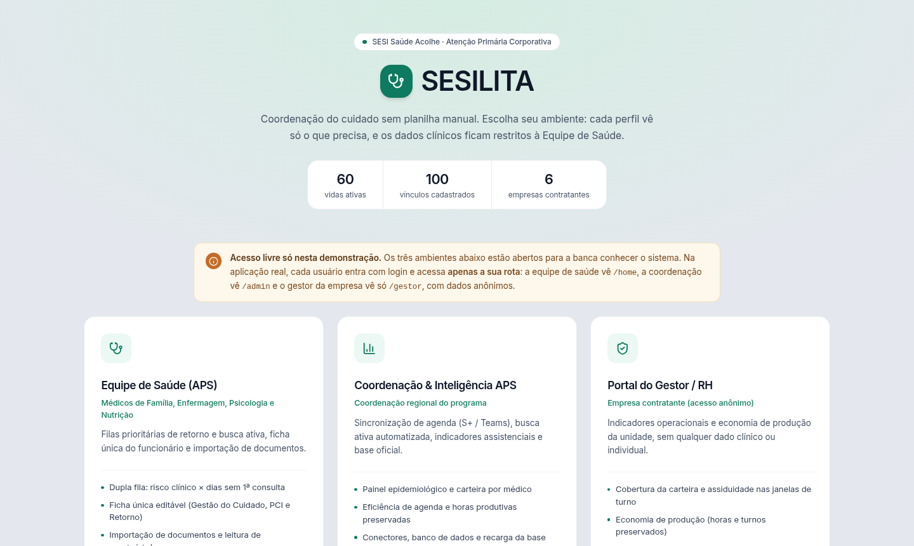
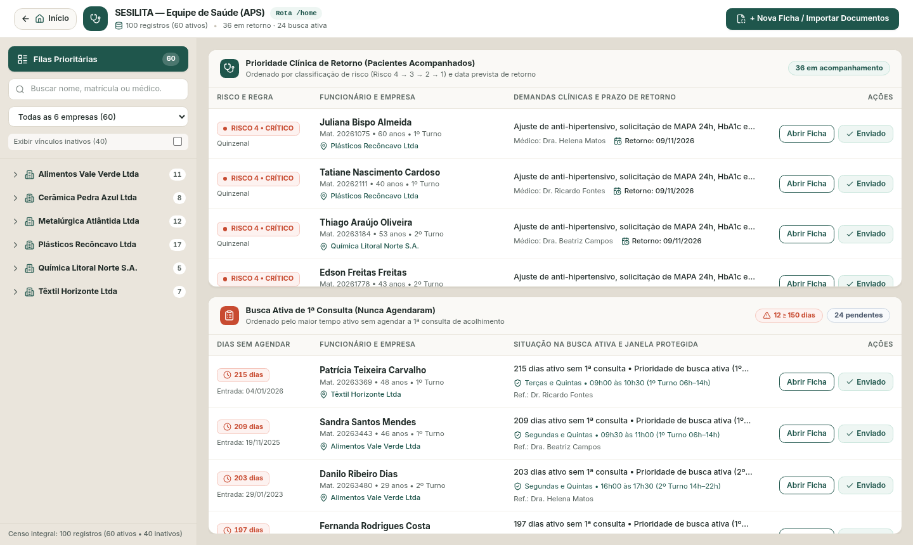
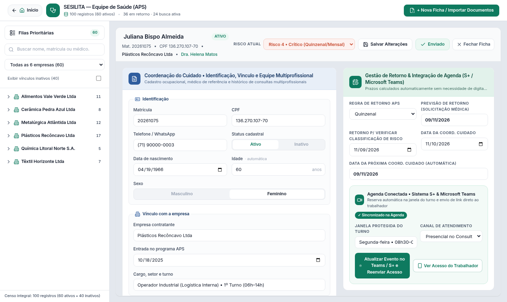
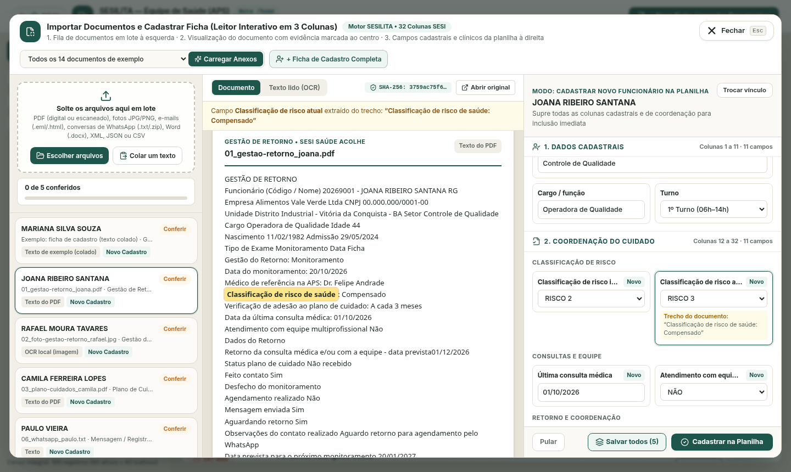
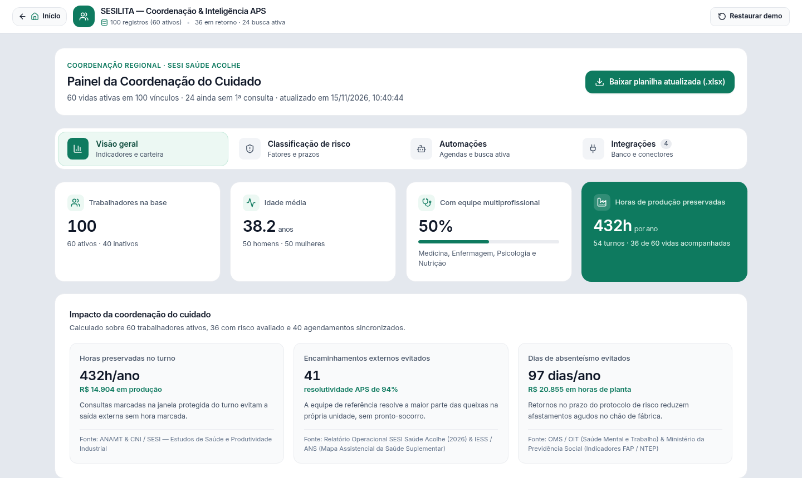
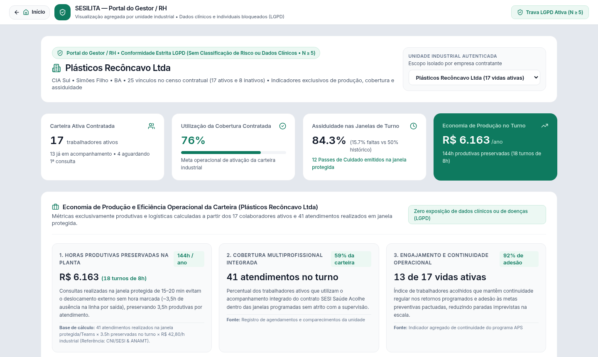

<div align="center">

# SESILITA

**Coordenação do Cuidado do SESI Saúde Acolhe, sem planilha manual e sem perder ninguém.**

Hackathon SESI Saúde 2026 · Atenção Primária à Saúde (APS) corporativa

[Demo online](https://sesilita.teagar.com.br) · [Como rodar](#como-rodar) · [Arquitetura](#arquitetura)



</div>

> **Todos os dados deste repositório são fictícios.** Trabalhadores, matrículas, CPFs, telefones e documentos de exemplo foram inventados para a demonstração. Nenhum dado real de saúde é usado.

---

## O problema

O SESI Saúde Acolhe oferece APS corporativa para **104 estabelecimentos industriais** na Bahia, cobrindo **10.025 vidas**, com **94% de resolutividade**, **96% de satisfação** e **NPS 97**. Mesmo assim, três dores travam o resultado:

| Dor | O que acontece hoje |
| :-- | :-- |
| **Abismo da 1ª consulta** | A empresa paga por cada vida ativa, mas muita gente nunca agenda o acolhimento. Na planilha de 32 colunas, ninguém vê há quantos dias alguém foi ativado sem consultar. |
| **No-show de ~50%** | Metade das consultas agendadas não acontece. |
| **Barreiras do trabalhador** | O Marcos, 38 anos, operador do 1º turno, não sai da linha sem o líder, não volta no contraturno (perde o ônibus), desiste de app com senha e tem medo de que o gestor saiba do diagnóstico. |

Além disso, a equipe passa horas **redigitando** relatórios do prontuário, e-mails e conversas de WhatsApp na planilha de Gestão do Cuidado.

## A solução

O SESILITA tem **três canais isolados**, cada um com só o que aquele perfil precisa ver.

### 1. Equipe de Saúde (`/home`): quem precisa de cuidado agora



- **Dupla fila automática.** Em cima, retorno clínico ordenado por **risco (4 → 1)** e atraso. Embaixo, **busca ativa da 1ª consulta**, ordenada por **mais dias sem agendar**.
- **Protocolo de risco APS embutido.** Risco 4 tem retorno quinzenal ou mensal, risco 3 a cada 3 meses e riscos 2 e 1 a cada 6 meses. Ao registrar a 1ª consulta, a pessoa migra sozinha da busca ativa para o acompanhamento.
- **Passe de Cuidado.** O botão **Enviar** manda pelo WhatsApp um horário já pactuado na **janela protegida do turno**. Ele vale como autorização para o líder, **sem revelar o motivo clínico**.



- **Ficha única, sem abas escondidas.** Gestão do Cuidado, Plano de Cuidados Individual e Gestão de Retorno ficam na mesma tela, com prazos calculados automaticamente.

### 2. Leitor de documentos: do documento à planilha, sem digitar



A equipe solta os documentos que já recebe hoje, e o SESILITA **lê, encontra o trabalhador e preenche os campos da planilha**. Nada é gravado sem a conferência de uma pessoa: cada campo mostra se é **Novo**, se **Muda** ou se está **Igual**, e de que trecho do documento o valor saiu.

| Chega como | Como é lido |
| :-- | :-- |
| PDF do prontuário (Gestão de Retorno, Plano de Cuidados, Gestão do Cuidado) | Camada de texto (pdf.js) e regras por rótulo |
| PDF escaneado, foto de celular, print de tela | **OCR local** (Tesseract, português) |
| E-mail `.eml`, inclusive anexos, ou e-mail salvo em HTML | Corpo do e-mail, com cada anexo lido de novo |
| Conversa de WhatsApp exportada (`.txt` ou `.zip`) | Só as falas do trabalhador, com a data da mensagem |
| Word `.docx`, XML, JSON, CSV, texto colado | Registros, sinônimos de coluna e intenção (confirmou, remarcou, faltou) |

O OCR roda **no próprio navegador**: nenhuma imagem ou documento é enviado a serviço externo nem a IA pública. Cada arquivo recebe um **hash SHA-256** para a custódia do prontuário. O leitor é baseado no projeto [SECILITA_PLANILHAS](https://github.com/Teagar/SECILITA_PLANILHAS).

### 3. Coordenação (`/admin`) e Gestor da empresa (`/gestor`)

| Coordenação & Inteligência APS | Portal do Gestor (LGPD) |
| :--: | :--: |
|  |  |

- **Coordenação (`/admin`)** traz o painel epidemiológico, a carteira por médico, a sincronização da planilha, o robô de busca ativa e os conectores (PostgreSQL, API SOC/S+, WhatsApp).
- **Gestor/RH (`/gestor`)** vê só **indicadores agregados e anônimos da própria empresa**, com trava **N ≥ 5**: cobertura, assiduidade nas janelas de turno e economia de produção. **Nunca** vê nome, CPF, matrícula, cargo, diagnóstico ou ficha.

## Diferenciais

- **Sigilo como regra de produto.** A LGPD está no código, não só na política: o canal do gestor não recebe dado individual, e a trava N ≥ 5 vale também na View Materializada do PostgreSQL.
- **Feito para o turno da fábrica.** As janelas protegidas e o Passe de Cuidado atacam o no-show onde ele nasce: a logística do turno e a autorização do líder.
- **Zero redigitação.** Qualquer documento que chega à equipe vira linha da planilha, com rastreio do trecho de origem.
- **Roda hoje.** É um app web leve, sem instalar nada para o trabalhador, com backend opcional (há modo offline em `localStorage`).

## Stack e por que escolhemos

O critério foi um só: **rodar hoje, em qualquer computador de unidade, sem custo de licença e sem tirar dado de saúde do controle do SESI.**

### Interface

| Tecnologia | Para que serve | Por que ela |
| :-- | :-- | :-- |
| **React 18** | Telas dos 3 canais | A ficha única tem dezenas de campos que se recalculam juntos (risco → regra de retorno → próxima consulta → fila). O modelo de estado do React deixa isso previsível, e é a biblioteca que mais gente sabe manter. |
| **TypeScript** | Todo o código, frontend e backend | Os mesmos contratos (`src/types.ts`) valem no navegador e na API. Um campo renomeado na planilha de 32 colunas quebra a compilação, não o plantão. |
| **Vite** | Servidor de desenvolvimento e build | Abre em menos de um segundo e recarrega ao salvar. O build sai como arquivos estáticos que qualquer servidor entrega. |
| **Tailwind CSS** | Estilo e design system | As cores de risco (1 a 4) e os tons de cada bloco ficam no próprio componente. Dá para ajustar o visual rápido, sem uma folha de estilo global que cresce sem controle. |
| **lucide-react** | Ícones | Leve, consistente e com licença livre. |

### Leitor de documentos (tudo no navegador)

| Tecnologia | Para que serve | Por que ela |
| :-- | :-- | :-- |
| **pdf.js** (Mozilla) | Ler PDFs do prontuário e gerar a prévia | É o leitor de PDF do Firefox: maduro, aberto e preserva a posição do texto, o que permite ler a ficha por rótulo ("Médico:", "Risco:"). |
| **Tesseract.js** + modelo em português | OCR de fotos, prints e PDFs escaneados | Roda **no próprio computador**. Documento de saúde não vai para nuvem nem para IA pública, o que simplifica a conformidade com a LGPD e funciona mesmo com internet ruim. |
| **postal-mime** | Ler e-mails `.eml` e seus anexos | Interpreta e-mails reais (codificações, anexos) sem depender de servidor. |
| **fflate** | Abrir `.zip` (conversa do WhatsApp) e `.docx` | Descompacta no navegador e é muito pequena. |
| **Web Crypto (SHA-256)** | Custódia de cada arquivo lido | Já vem no navegador. O hash prova que o documento arquivado é o mesmo que foi lido. |

### Servidor e dados

| Tecnologia | Para que serve | Por que ela |
| :-- | :-- | :-- |
| **Node.js + Express** | API REST (filas, ficha, Passe de Cuidado, automações) | Mesma linguagem do frontend, então as regras de negócio (`queueService.ts`) são **o mesmo código** na tela e na API. |
| **Banco JSON local** (`server/data`) | Persistência da demonstração | Zero instalação: a banca roda com `npm run dev`. A interface também funciona sem a API, guardando em `localStorage`. |
| **PostgreSQL 16** (`server/schema.sql`) | Caminho para produção | Tabelas normalizadas e a View Materializada com a trava LGPD **N ≥ 5** no próprio banco, para que o anonimato não dependa só da tela. |
| **tsx** e **esbuild** | Rodar os scripts em TypeScript e empacotar a API | Os robôs (sincronização da planilha, busca ativa) rodam direto do `.ts`, e a API vira um único arquivo para produção. |
| **Docker + Caddy** | Deploy | Imagem sem dependências desnecessárias, rodando sem root e com sistema de arquivos somente leitura. O Caddy emite e renova o HTTPS sozinho. |

## Como rodar

Requisitos: Node.js 20+.

```bash
npm install
npm run dev          # API em :3001 + app em http://localhost:5173
```

| Comando | O que faz |
| :-- | :-- |
| `npm run dev` | Sobe a API Express (porta 3001) e o Vite (porta 5173), copiando antes o OCR local para `public/ocr` |
| `npm run build` | Gera o build estático em `dist/` |
| `npm run audit` | Verifica as regras de negócio, a trava LGPD e a leitura dos 14 documentos de exemplo (reseta o banco de demonstração) |
| `npm run sync:csv` | Sincroniza a planilha oficial (100 linhas) com a base |
| `npm run cron:bot` | Roda o robô de busca ativa e emite Passes de Cuidado em lote |
| `npm run demo` | Regenera os 14 documentos fictícios de exemplo (precisa de `pdftoppm` e ImageMagick) |

**Para testar o leitor:** abra `/home`, clique em **+ Nova Ficha / Importar Documentos**, escolha *Todos os 14 documentos de exemplo* e clique em **Carregar Anexos**.

## Arquitetura

```text
┌──────────────── Navegador (React + Vite + Tailwind) ─────────────────┐
│  /home Equipe de Saúde    /admin Coordenação    /gestor Gestor (LGPD) │
│  Leitor de documentos: pdf.js · Tesseract (OCR local) · postal-mime  │
└───────────────────────────────┬──────────────────────────────────────┘
                                │ /api (proxy Vite) · fallback localStorage
┌───────────────────────────────▼──────────────────────────────────────┐
│  API Express + TypeScript (server/index.ts, porta 3001)              │
│  Persistência JSON (server/data) · Planilha CSV consolidada (data/)  │
│  Modo enterprise: server/schema.sql (PostgreSQL 16 + View LGPD N≥5)  │
└──────────────────────────────────────────────────────────────────────┘
```

```text
src/
├── App.tsx                     # Shell e rotas (/, /home, /admin, /gestor)
├── queueService.ts             # Motor de filas, protocolo de risco e indicadores
├── secilitaEngine.ts           # Extração de documentos → 32 colunas da planilha
├── ingest/                     # Leitura de PDF (pdf.js) e OCR local (Tesseract)
├── demo/people.json            # Pessoas fictícias dos 14 documentos de exemplo
└── components/                 # TopBar, filas, ficha, importação, canais
server/                         # API, conector de banco e DDL PostgreSQL
scripts/                        # Sincronização CSV, robô de busca ativa, auditoria, gerador de exemplos
public/demo/                    # 14 documentos de exemplo (fictícios)
```

## Equipe e créditos

- Repositório original do protótipo: [CalysonB/HEALTHX---Hackathon-SESI-Sa-de-2026](https://github.com/CalysonB/HEALTHX---Hackathon-SESI-Sa-de-2026)
- Leitor de documentos baseado em [Teagar/SECILITA_PLANILHAS](https://github.com/Teagar/SECILITA_PLANILHAS)
- Projeto de demonstração para o Hackathon SESI Saúde 2026. Todos os dados são fictícios.
